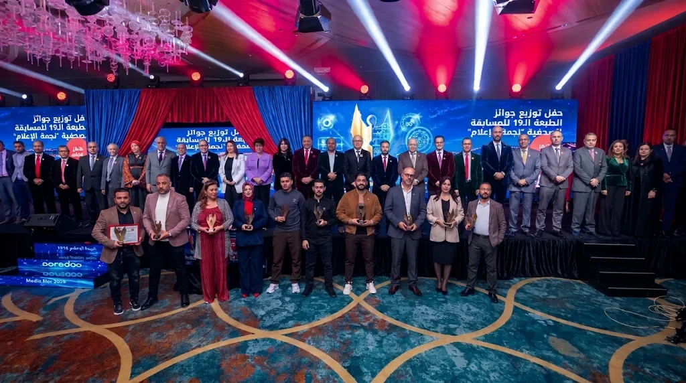

Alger, 19 novembre 2026 (Algeria Tech) — Ooredoo a décerné les prix de la 19ème édition de son concours Media Star le lundi 16 novembre 2026 à Alger. Douze journalistes ont été récompensés parmi 164 participants pour leurs travaux sur l'impact de l'intelligence artificielle et de la 5G.

## Une cérémonie sur l'IA et la 5G

La cérémonie de remise des prix s'est tenue à l'hôtel Sheraton d'Alger, sur le thème « L'impact de l'intelligence artificielle et de la 5G sur les transformations socio-économiques en Algérie ». Elle a réuni des personnalités du monde médiatique, technologique et numérique. Le ministre de la Communication, Mohamed Bouslimani, était présent pour honorer les lauréats. Roni Tohme, directeur général d'Ooredoo Algérie, a ouvert la cérémonie en soulignant l'importance de l'excellence journalistique dans un contexte de mutations technologiques.

## Les lauréats

Sur 164 candidats, 12 journalistes ont été distingués dans quatre catégories. Le jury était présidé par Mme Zahia Benarous. Les prix ont été revalorisés pour cette édition : 750 000 DZD pour le 1er prix, 500 000 DZD pour le 2e et 300 000 DZD pour le 3e.

| Catégorie | 1er prix | 2e prix | 3e prix |
|---|---|---|---|
| Presse écrite | Mustapha Bastami | Guesmi Salah Eddine | Arsouli Amina |
| Médias électroniques | Bouras Sid Ali | Rekkab Mounir | Choudar Souhaib |
| Programmes radiophoniques | Amari Abdelkader | Achir Fahima | Belhadj Nassima Amel |
| Programmes télévisuels | Gaci Sonia | Hocine Mohamed Bahaa Eddine | Bouichat Reda |

## Un engagement affiché pour le journalisme

Par ce concours, Ooredoo dit vouloir promouvoir une couverture médiatique innovante et responsable, en alignant les médias sur les transformations numériques du pays. La présence du ministre de la Communication souligne l'importance accordée à ce secteur.

## À retenir

- Ooredoo a remis les prix de la 19ème édition de Media Star le 16 novembre 2026 à Alger.
- 12 journalistes ont été distingués parmi 164 candidats, dans quatre catégories.
- Les prix vont de 300 000 à 750 000 DZD.
- Le ministre de la Communication, Mohamed Bouslimani, a assisté à la cérémonie.

## Sources

- Source : communiqué de presse d'Ooredoo Algérie
