التزام متجدد بدعم الشباب والتميز المهني

Ooredoo الجزائر الراعي البلاتيني للأولمبياد الإفريقي للمهن 2026 بوهران

الجزائر – السبت 21 نوفمبر 2026

وفاءً لالتزامها بدعم الشباب وتنمية الكفاءات وترقية المواهب، رافقت Ooredoo     الجزائر، بصفتها راعي بلاتيني، فعاليات الطبعة الثانية من الأولمبياد الإفريقي للمهن 2026، التي احتضنتها مؤخرا مدينة وهران.

تحت الرعاية السامية لرئيس الجمهورية، السيد عبد المجيد تبون، ومن تنظيم وزارة التكوين والتعليم المهنيين، جمعت هذه التظاهرة القارية شباباً متنافسين من 18 دولة أفريقية، جاؤوا لاستعراض مهاراتهم وإبراز مكتسباتهم المهنية، والتنافس في مختلف التخصصات.

حضي جناح العرض الخاص بـ Ooredooالجزائر في هذه الفعالية بزيارة السيدة نسيمة أرحاب، وزيرة التكوين والتعليم المهنيين، التي اطلعت على مختلف مبادرات المؤسسة في مجال التكوين. 

خلال الحفل الختامي لهذا الحدث القاري، تم تكريم مؤسسة Ooredoo تقديراً لرعايتها ودعمها لهذه التظاهرة ذات البعد القاري.

بمشاركة أكثر من 600 متنافس في مسابقات شملت 45 مهنة، شكّلت هذه الطبعة فضاءً للتبادل واكتساب الخبرات والتنافس الإيجابي، وفرصة لتعزيز وتثمين الكفاءات المهنية على مستوى القارة الإفريقية. في هذا الإطار نظم ممثلون عن مؤسسة Ooredoo ورشة عمل تحت عنوان꞉ "الريادة في عصر الذكاء الاصطناعي".

بمرافقتها لهذا الحدث، تؤكد Ooredoo الجزائر حرصها على المساهمة في المبادرات التي تضع تنمية العنصر البشري في صميم اهتماماتها، وتُثَمّن المواهب والكفاءات.

مديرية الشؤون المؤسساتية والعلاقات مع الإعلام والمسؤولية المجتمعية

دائرة العلاقات مع الإعلام

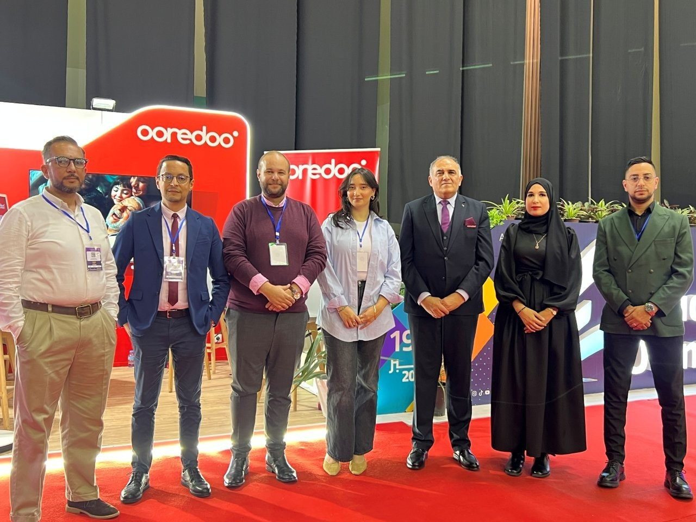

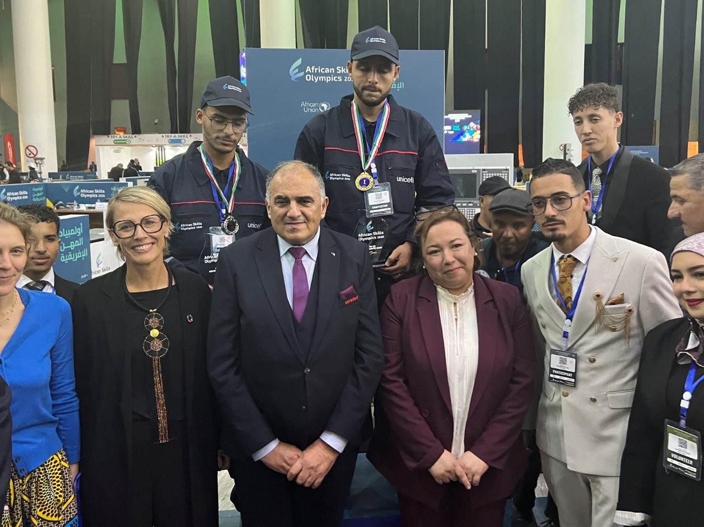

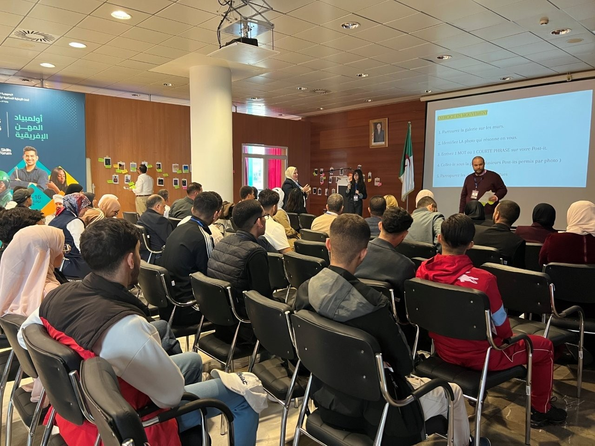

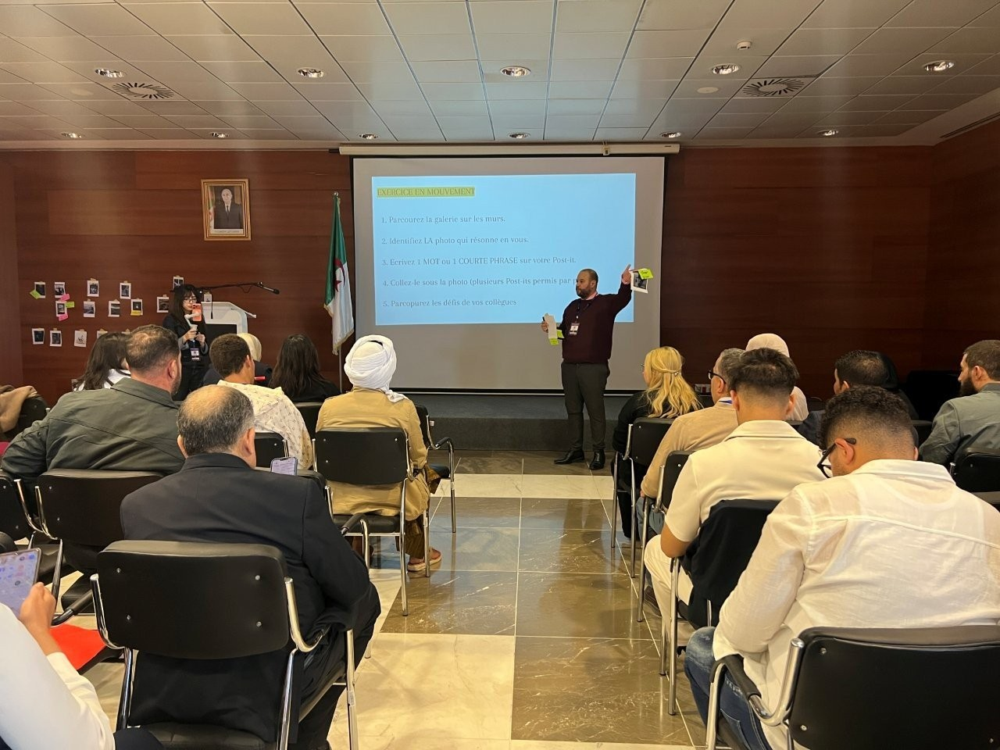

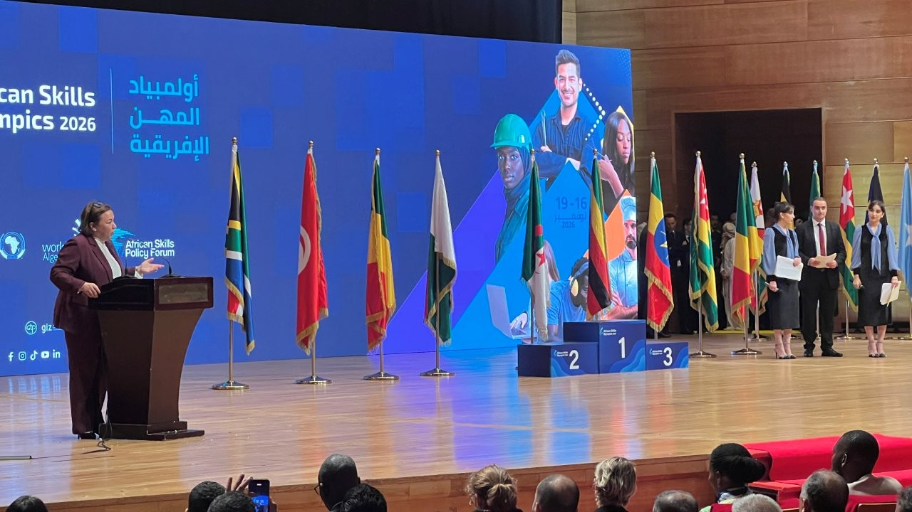

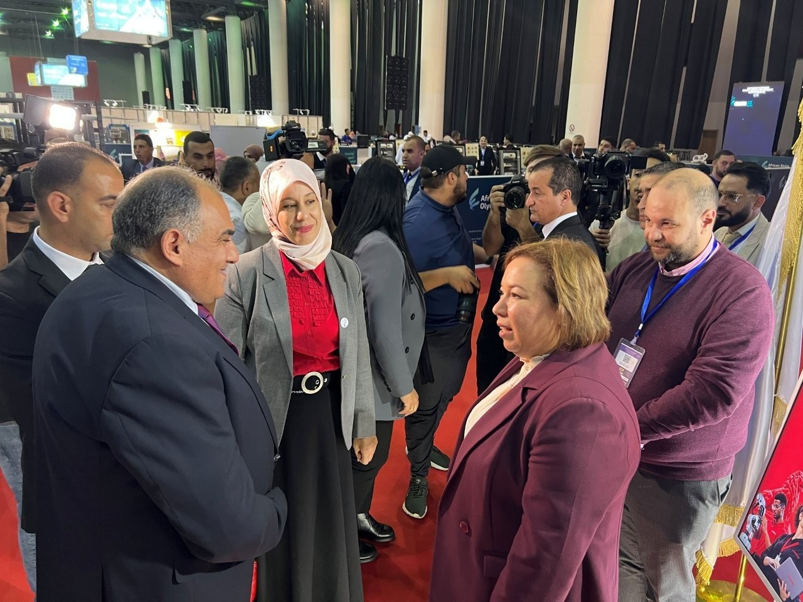

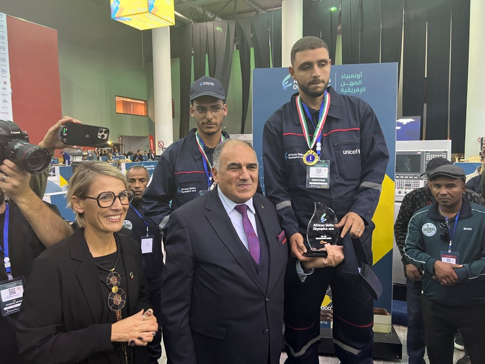

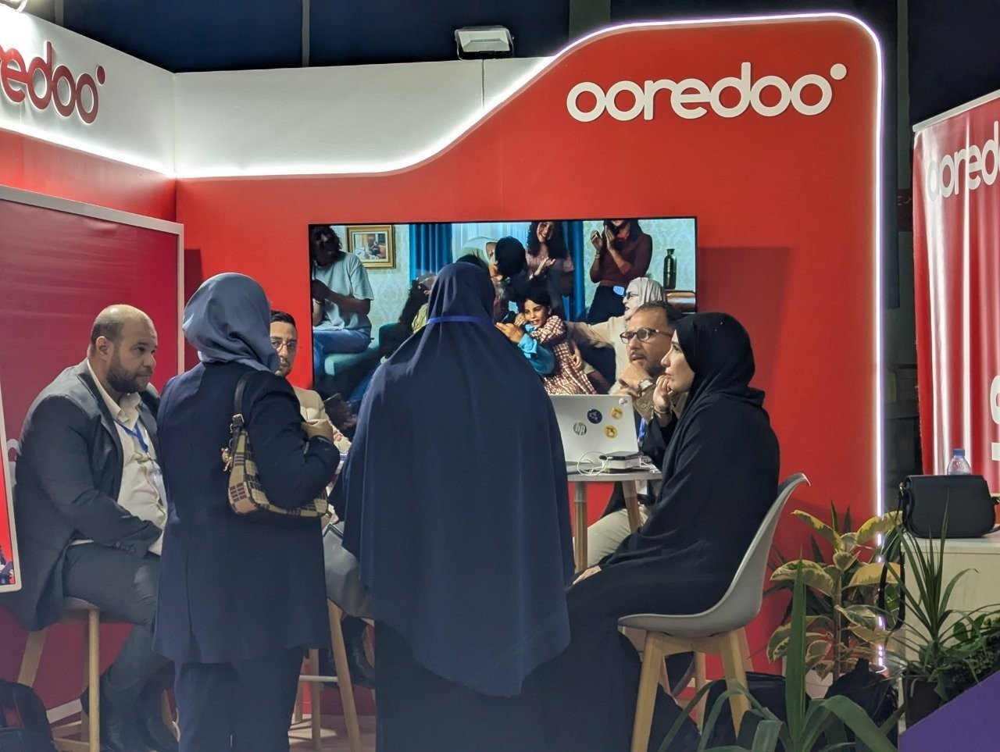

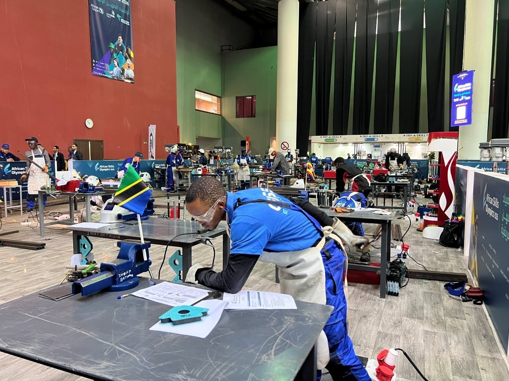

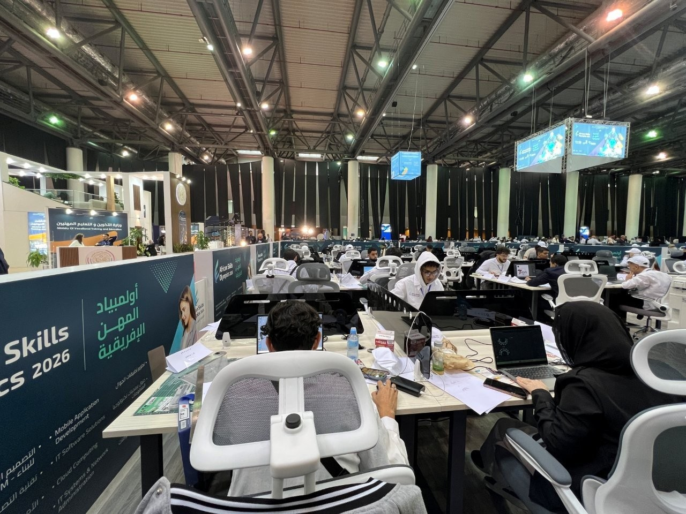

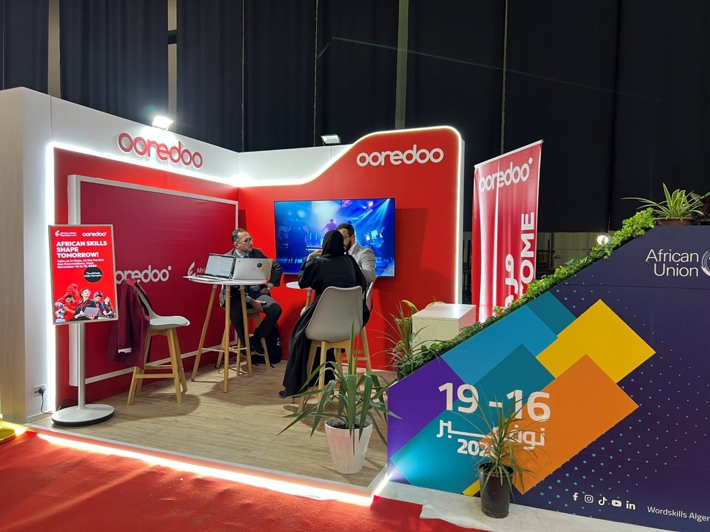

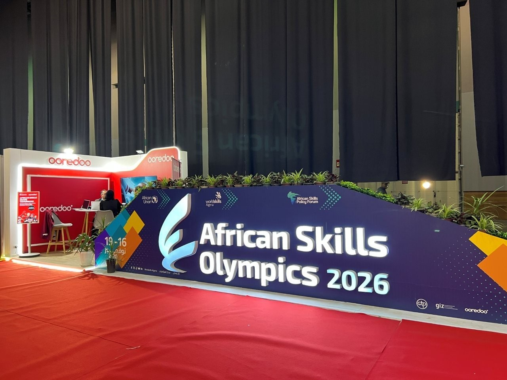

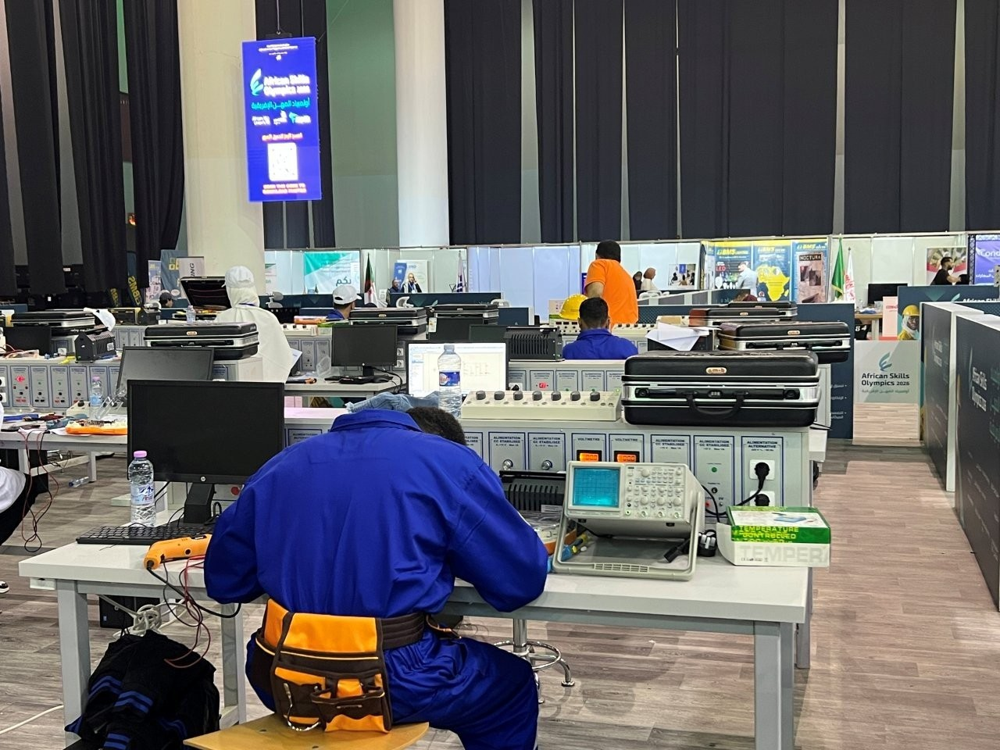

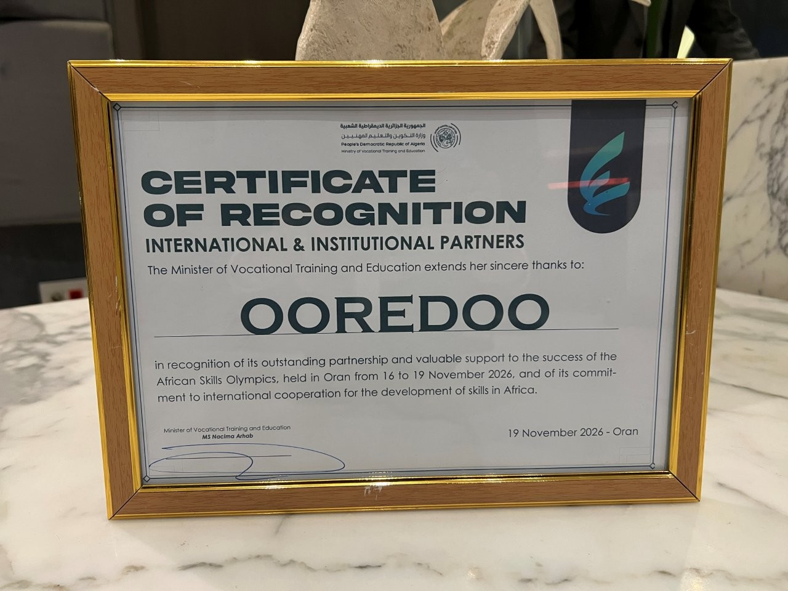
