## Accompagnement des compétences et du développement humain à Oran

Organisée par le ministère de la Formation et de l'Enseignement professionnels, cette manifestation a réuni des jeunes compétiteurs en provenance de 18 pays du continent. Les candidats ont confronté leurs capacités techniques dans un esprit de compétition positive et d'échange d'expériences.

La ministre de la Formation et de l'Enseignement professionnels, Mme Nassima Arhab, a visité l'espace d'exposition de l'opérateur. La responsable a pris connaissance des différentes démarches entreprises par la société dans le domaine de la formation.

En marge des épreuves, des représentants de l'entreprise ont animé un atelier de travail intitulé « Le leadership à l'ère de l'intelligence artificielle ». Lors de la cérémonie de clôture, l'entreprise a été distinguée pour son accompagnement de cet événement d'envergure africaine.

| Donnée | Détail |
|---|---|
| Événement | 2e édition des Olympiades africaines des métiers 2026 |
| Lieu | Oran |
| Statut d'Ooredoo | Sponsor Platinum |
| Organisateur | Ministère de la Formation et de l'Enseignement professionnels |
| Nombre de pays | 18 |
| Nombre de candidats | Plus de 600 |
| Spécialités représentées | 45 métiers |
| Thème de l'atelier Ooredoo | Le leadership à l'ère de l'intelligence artificielle |

## À retenir
- Ooredoo Algérie a agi en tant que sponsor Platinum de la 2e édition des Olympiades africaines des métiers 2026 à Oran.
- La manifestation a été placée sous le haut patronage du président de la République, Abdelmadjid Tebboune.
- Le ministère de la Formation et de l'Enseignement professionnels a pris en charge l'organisation du rassemblement.
- La rencontre a réuni plus de 600 participants issus de 18 pays africains dans 45 spécialités.
- La ministre Nassima Arhab s'est rendue sur le stand d'Ooredoo pour découvrir ses initiatives de formation.
- Les équipes d'Ooredoo ont animé un atelier axé sur le leadership et l'intelligence artificielle.
- L'opérateur télécom a reçu une distinction durant la cérémonie de clôture.

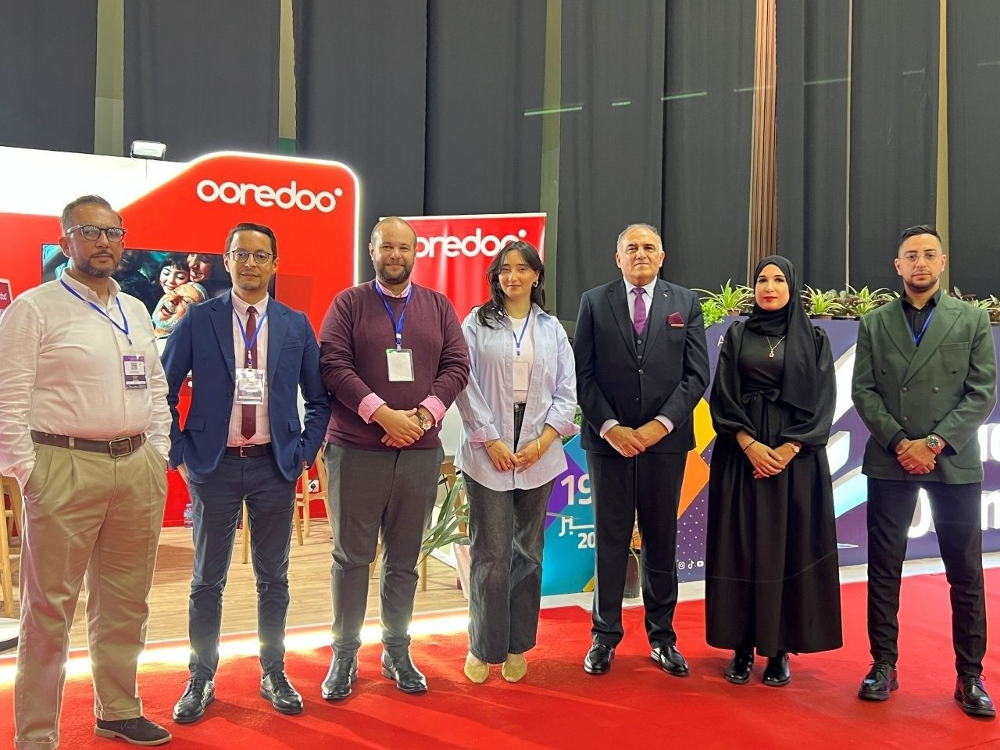

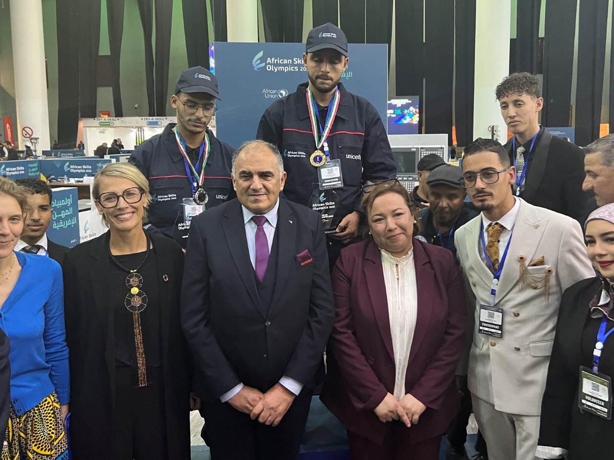

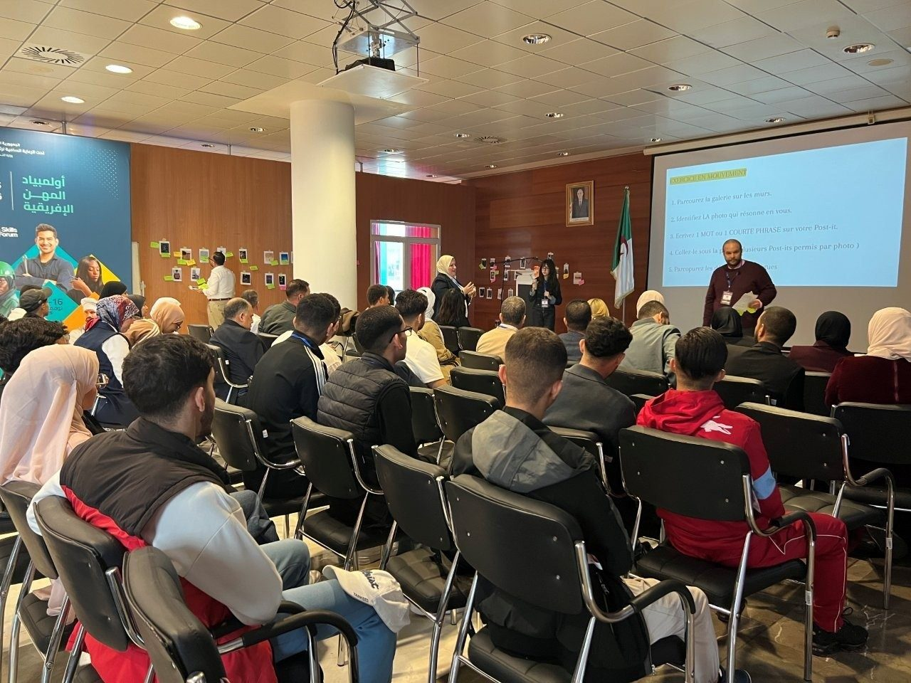

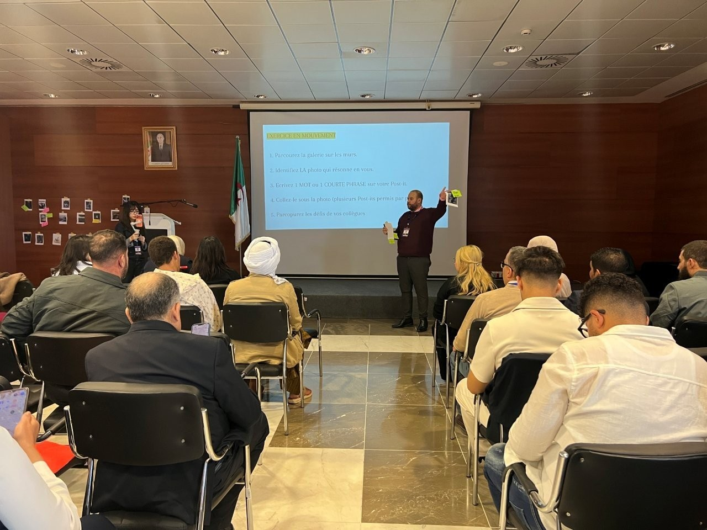

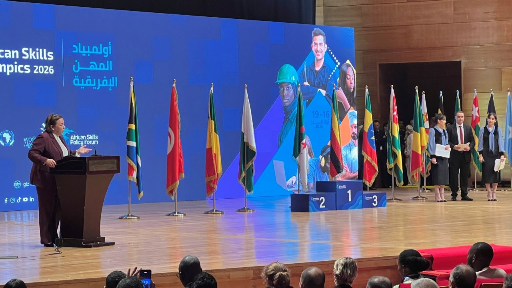

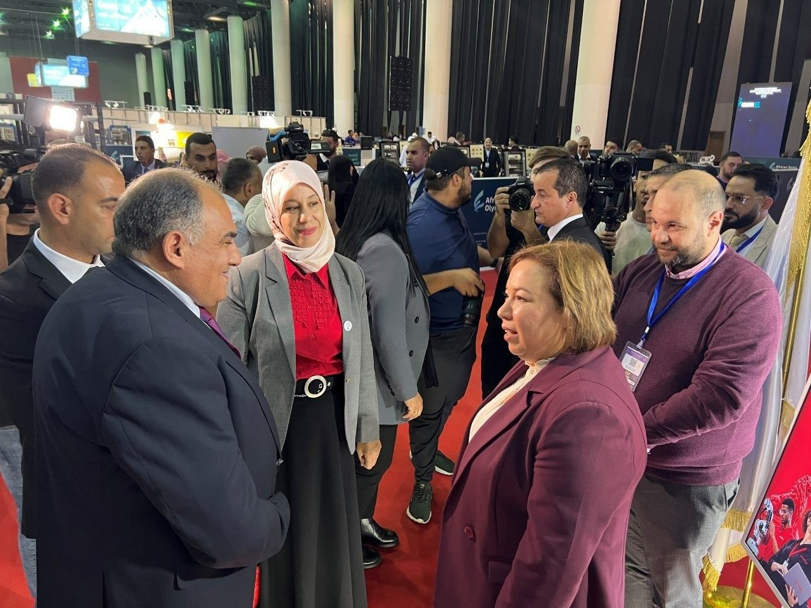

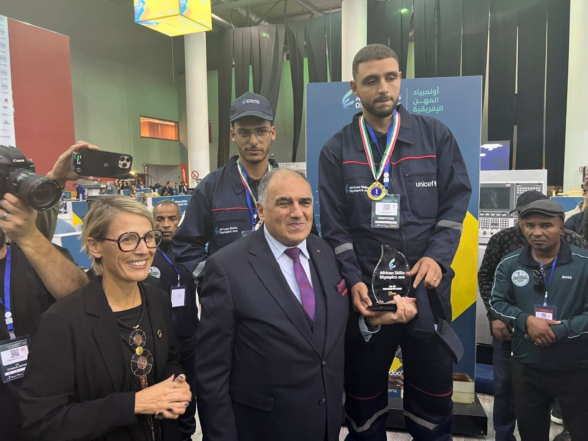

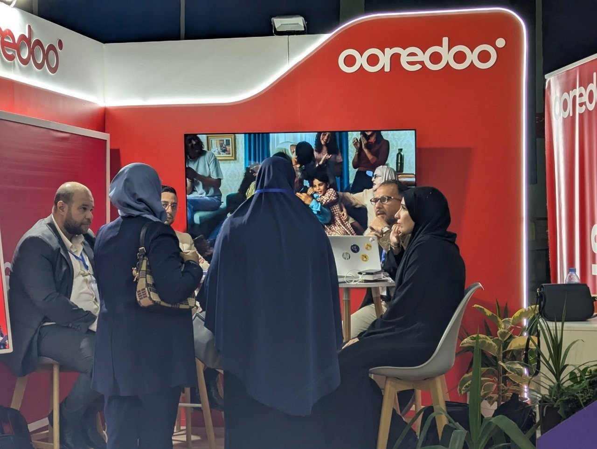

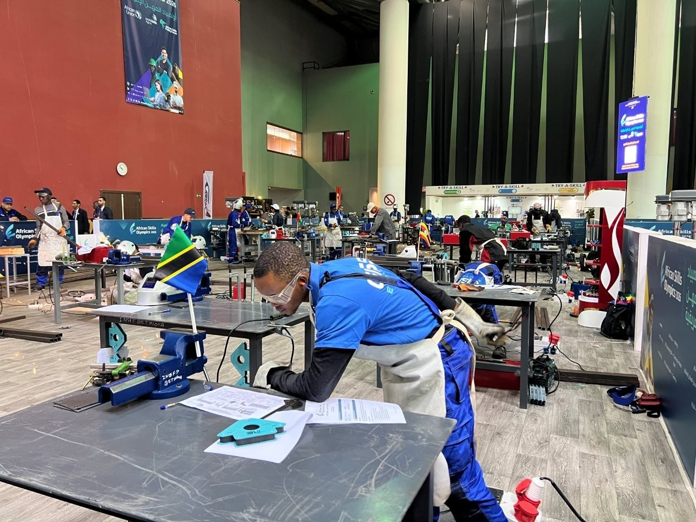

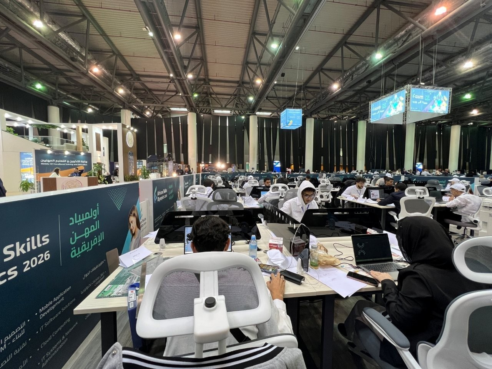

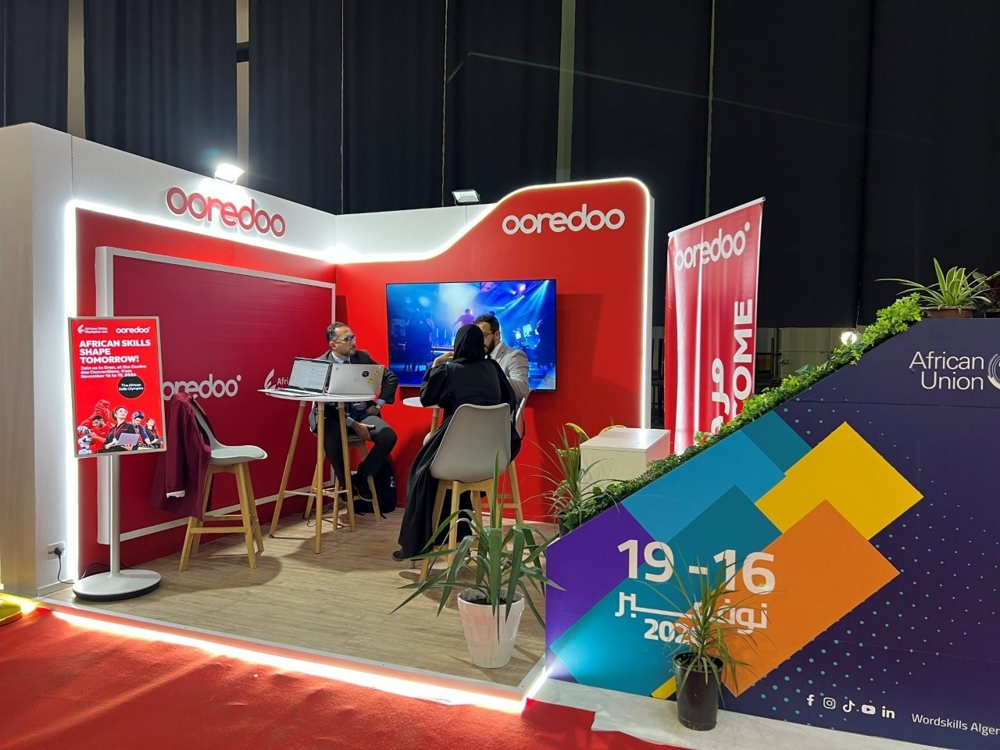

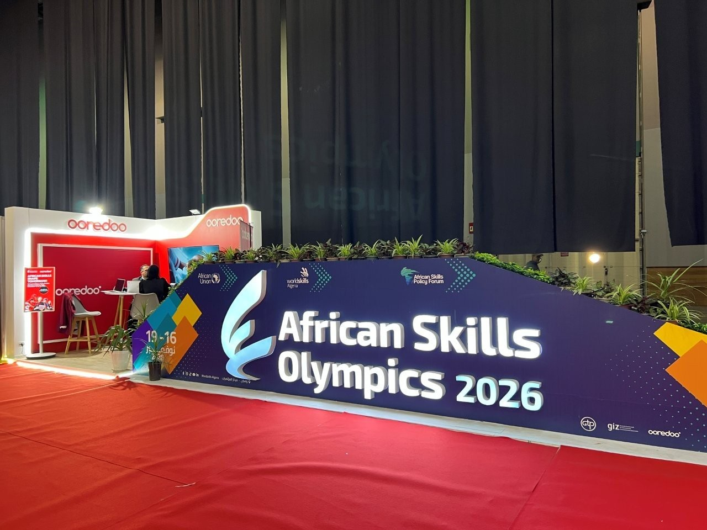

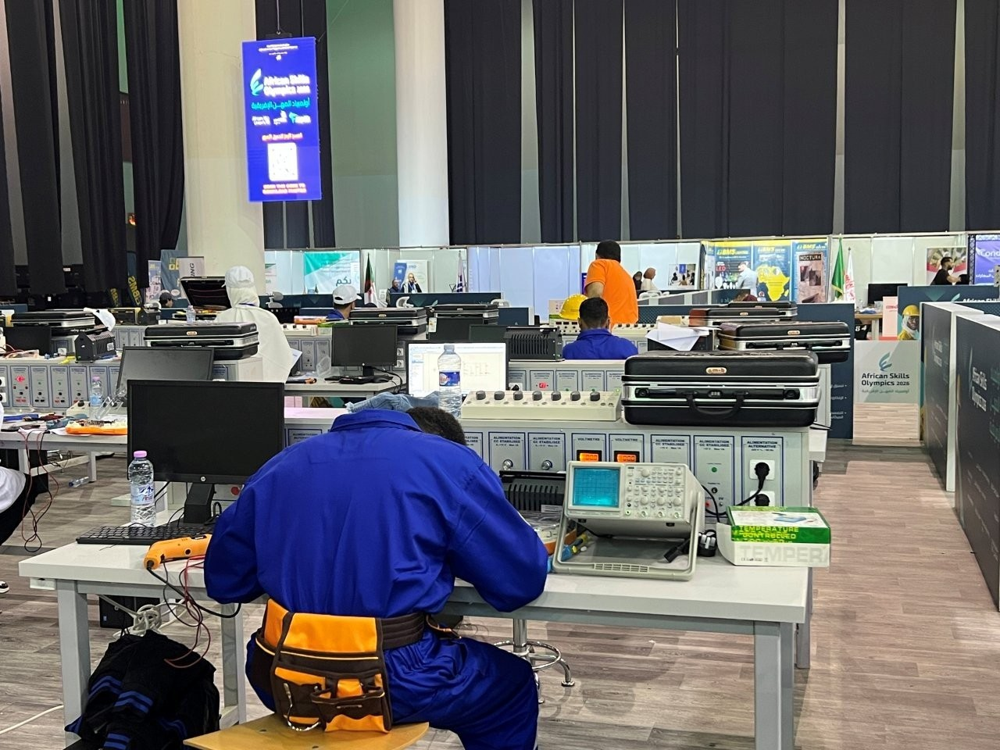

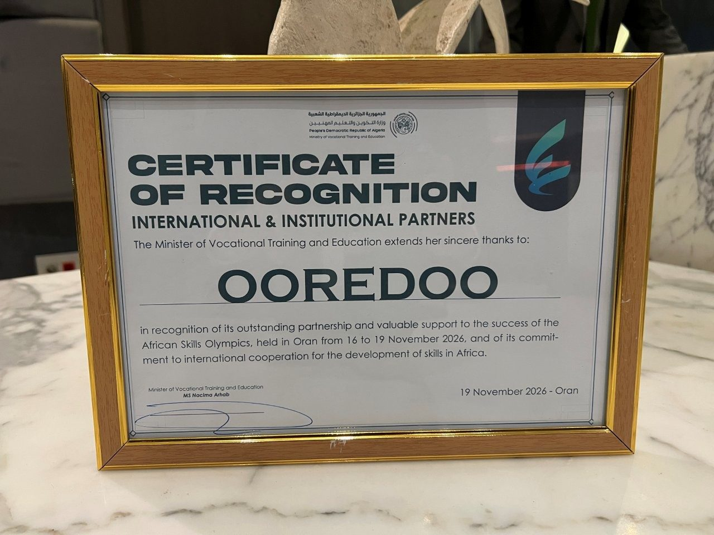
