بالشراكة مع الوكالة الوطنية للدم

Ooredoo الجزائر تجدّد التزامها التضامني من خلال تنظيم عملية للتبرع بالدم

 الجزائر، الاثنين 23 نوفمبر 2026

تجسيدًا لالتزامها المتواصل في مجال المسؤولية المجتمعية، نظّمت Ooredoo الجزائر، يوم الإثنين 23 نوفمبر 2026، بالتعاون مع الوكالة الوطنية للدم، ثالث عملية للتبرع بالدم لفائدة عمالها لهذه السنة، وذلك على مستوى مقراتها الثلاثة بكل من الجزائر العاصمة، وهران وقسنطينة.

أضحت هذه المبادرة تقليدًا راسخًا ضمن استراتيجية المؤسسة والتزامها الدائم في مجال المسؤولية المجتمعية، حيث تعكس هذه الحملة الجديدة حرص Ooredoo على ترسيخ ثقافة التبرع الطوعي بالدم، وتحسيس عمالها بأهمية هذا العمل الإنساني النبيل الذي يساهم في إنقاذ الأرواح.

أشرف على هذه العملية طاقم طبي تابع للمؤسسة العمومية الاستشفائية "الطيب بوقاسمي" بزرالدة، بالتنسيق مع فرق طب العمل لـ Ooredoo وممثلي الوكالة الوطنية للدم. وقد جرت هذه المبادرة بحضور كل من المدير العام للوكالة الوطنية للدم، البروفيسور عصام فريقع، مدير الشؤون المؤسساتية والعلاقات مع الاعلام والمسؤولية المجتمعية، السيد رمضان جزايري وكذا المديرة بالنيابة للموارد البشرية لـ Ooredoo، السيدة نسرين رحال. 

يجدر الذكر إلى أن Ooredoo الجزائر نظّمت منذ مطلع السنة الجارية حملتين للتبرع بالدم، خلال شهري أفريل وجويلية 2026، عاكسة بذلك روح الالتزام والتضامن التي يتحلى بها عمال Ooredoo، وحرصهم الدائم على المساهمة الفعالة في المبادرات التضامنية والإنسانية.

من خلال هذه المبادرة الجديدة، تؤكد Ooredoo الجزائر مجددًا التزامها كمؤسسة مواطنة، وتمسّكها بقيم المسؤولية والتقاسم والتآزر، ومواصلة مساهمتها في دعم الجهود الرامية إلى ترسيخ ثقافة التضامن والتكافل في المجتمع.

مديرية الشؤون المؤسساتية والعلاقات مع الإعلام والمسؤولية المجتمعية

دائرة العلاقات مع الإعلام

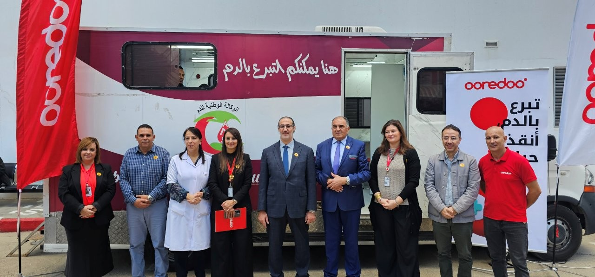

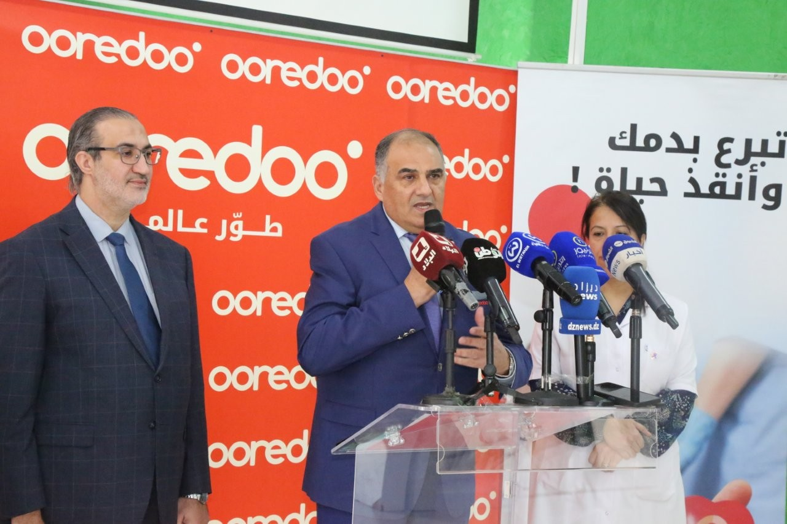

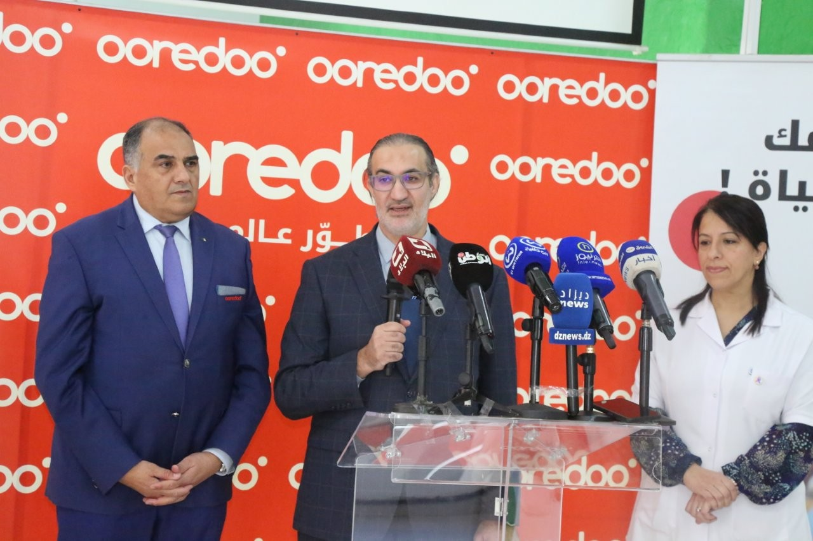

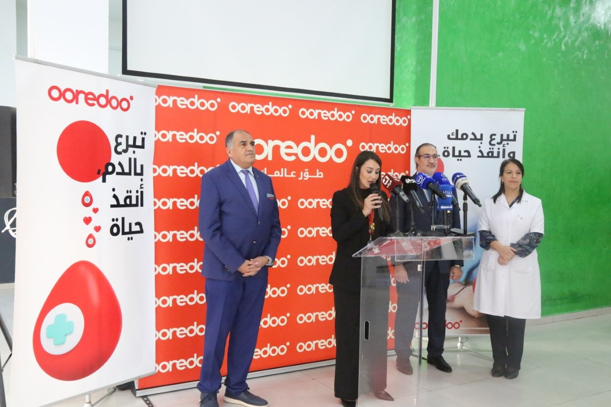

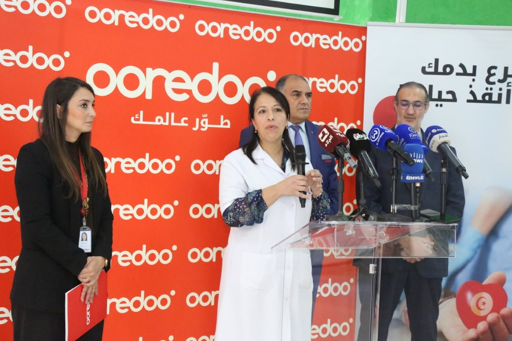

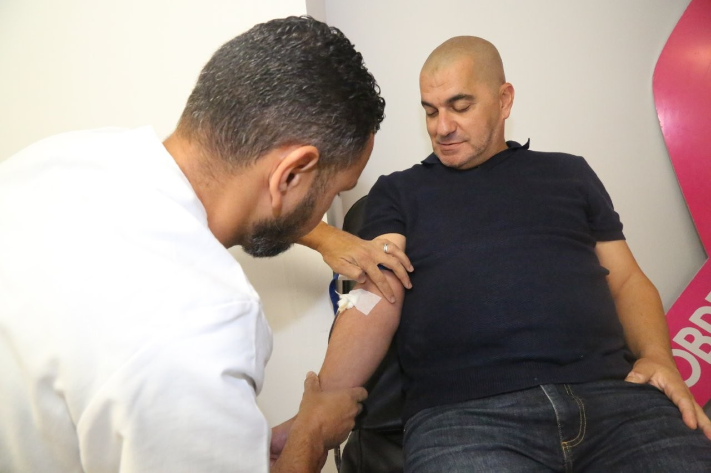

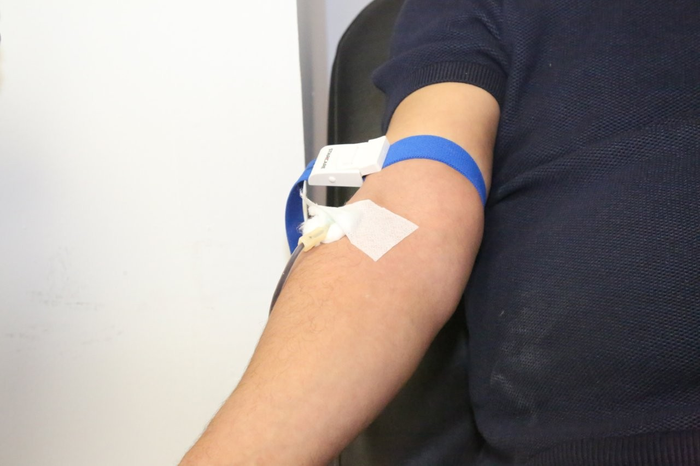

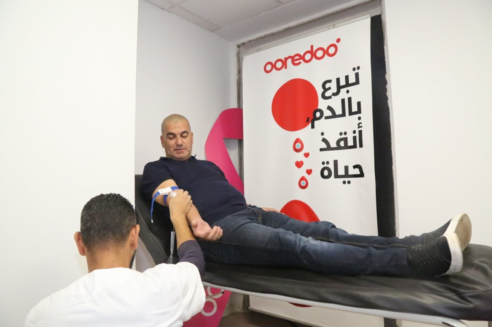

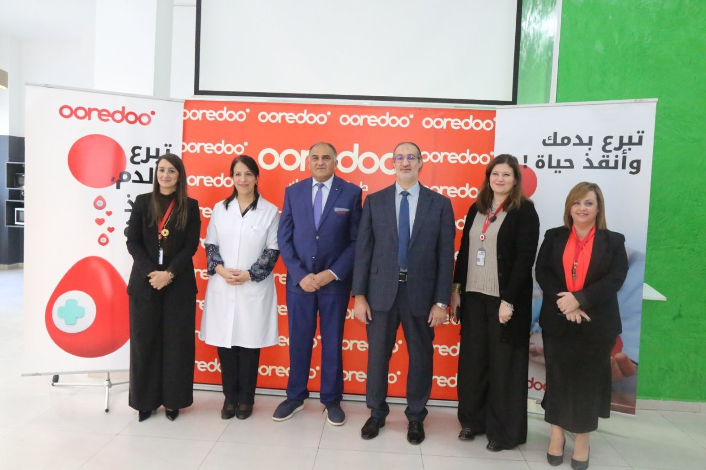

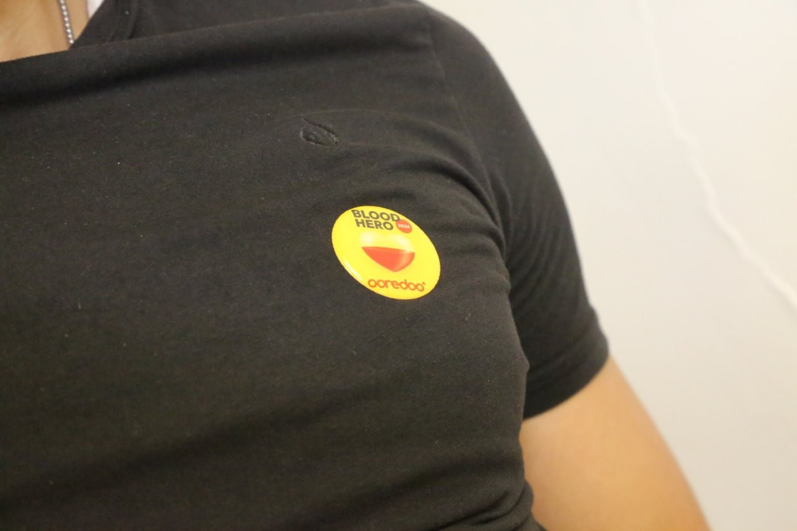

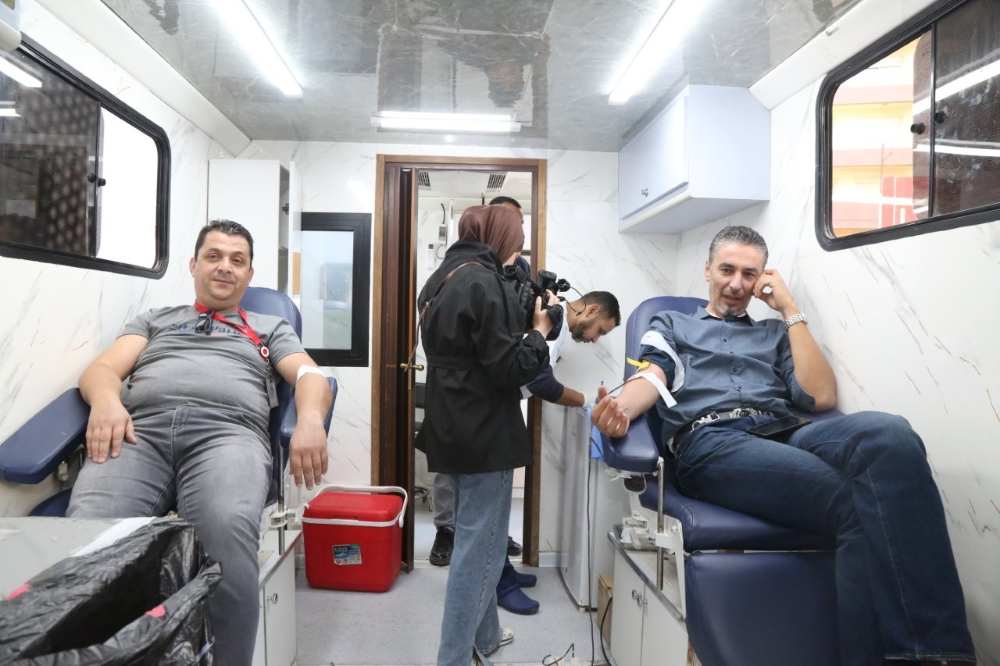

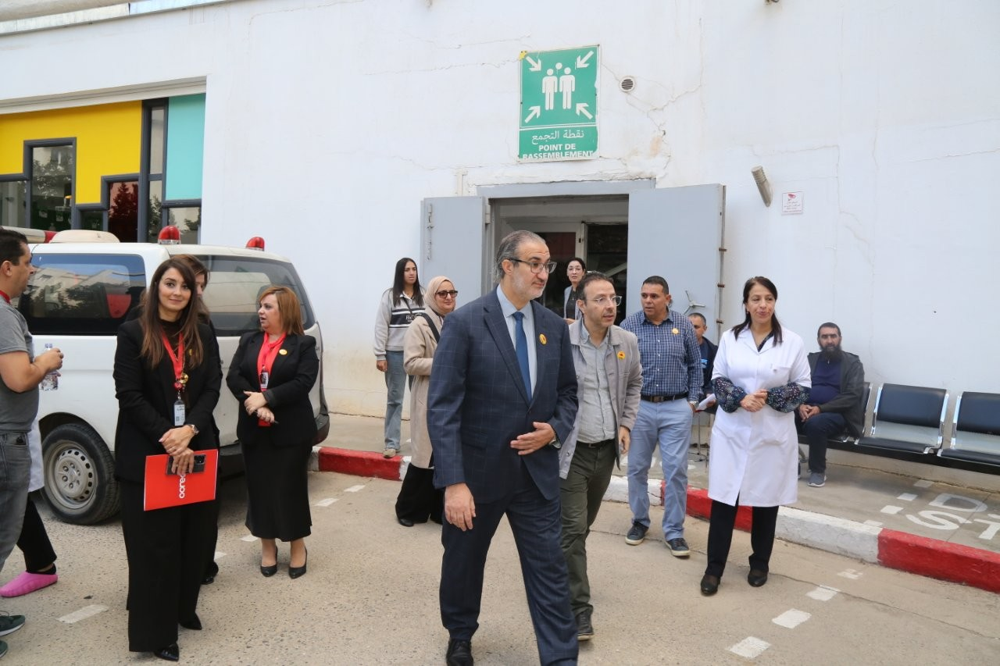

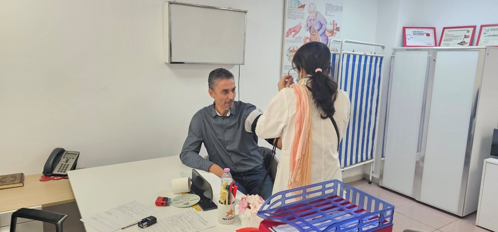
