## Campagne de solidarité au profit des employés

L'entreprise Ooredoo Algérie a mené, le lundi vingt-trois novembre deux mille vingt-six, sa troisième action de don de sang de l'année destinée à son personnel. Cette initiative citoyenne s'est déroulée simultanément au niveau des trois structures de la société situées à Alger, Oran et Constantine, en partenariat avec l'Agence nationale du sang.

Cet événement s'inscrit dans le cadre de la stratégie de responsabilité sociétale de l'entreprise, visant à promouvoir le don volontaire de sang et à sensibiliser les travailleurs à cette action humanitaire.

| Informations | Détails |
|---|---|
| Date | Lundi 23 novembre 2026 |
| Partenaire | Agence nationale du sang |
| Villes concernées | Alger, Oran, Constantine |
| Encadrement médical | Équipe médicale de l'Établissement public hospitalier "Tayeb Bouskassimi" de Zeralda, équipes de médecine du travail de Ooredoo et représentants de l'Agence nationale du sang |
| Personnalités présentes | Professeur Issam Frihac (Directeur général de l'Agence nationale du sang), Ramdane Djezairi (Directeur des affaires institutionnelles, des relations avec les médias et de la responsabilité sociétale), Nesrine Rahal (Directrice par intérim des ressources humaines) |

L'encadrement de cette opération a été assuré par un personnel médical issu de l'Établissement public hospitalier "Tayeb Bouskassimi" de Zeralda, en coordination avec la médecine du travail de l'opérateur et l'Agence nationale du sang. Le directeur général de l'Agence nationale du sang, le professeur Issam Frihac, le directeur des affaires institutionnelles, des relations avec les médias et de la responsabilité sociétale, Ramdane Djezairi, ainsi que la directrice par intérim des ressources humaines, Nesrine Rahal, ont assisté à cette démarche.

Il convient de rappeler que deux campagnes similaires avaient déjà été menées par Ooredoo Algérie depuis le début de l'année, durant les mois d'avril et de juillet deux mille vingt-six, illustrant l'engagement solidaire des équipes.

## À retenir
- Organisation d'une troisième opération de don de sang par Ooredoo Algérie le vingt-trois novembre deux mille vingt-six.
- L'action s'est déroulée dans les trois sièges de l'entreprise à Alger, Oran et Constantine.
- Partenariat établi avec l'Agence nationale du sang.
- Présence du directeur général de l'Agence nationale du sang, le professeur Issam Frihac.
- Deux autres campagnes similaires avaient été organisées en avril et juillet deux mille vingt-six.

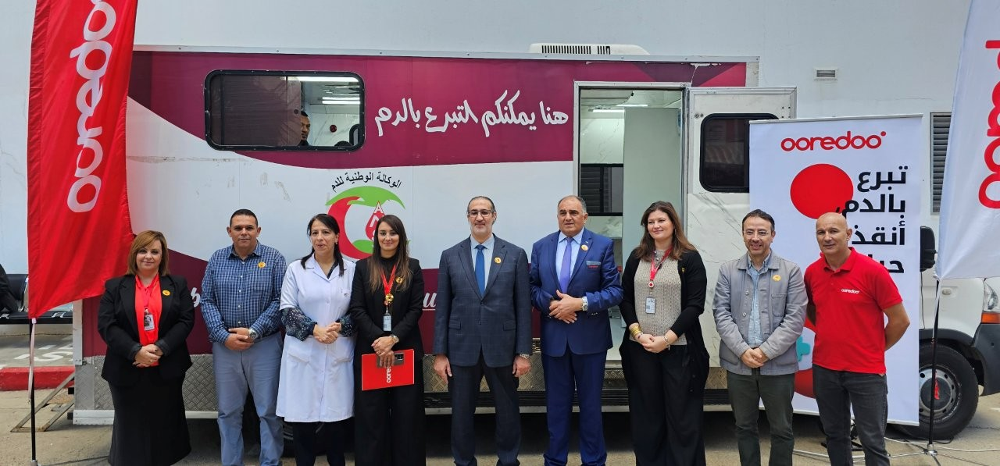

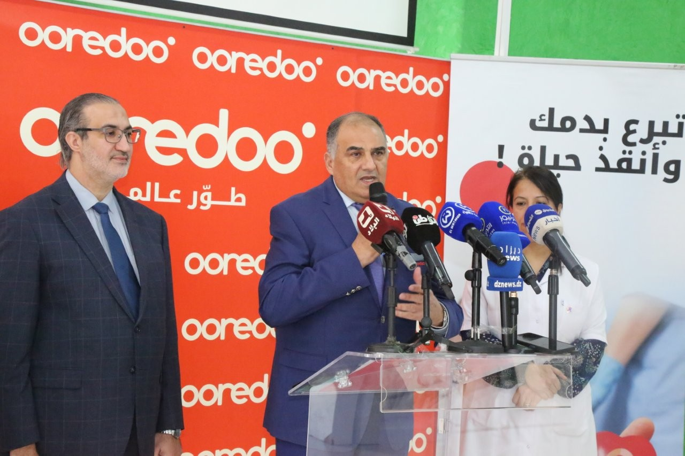

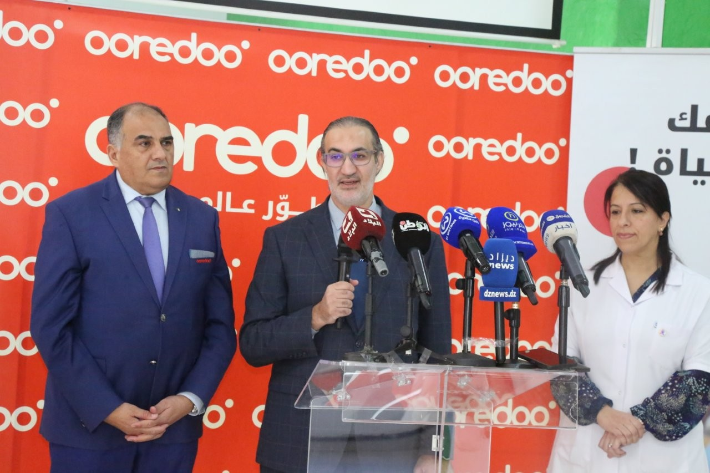

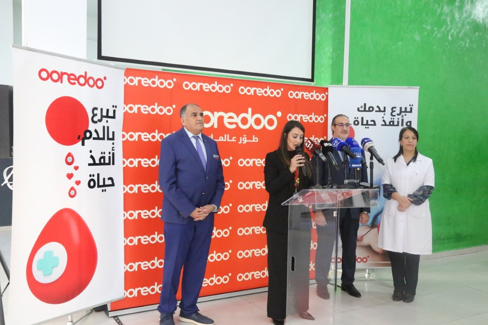

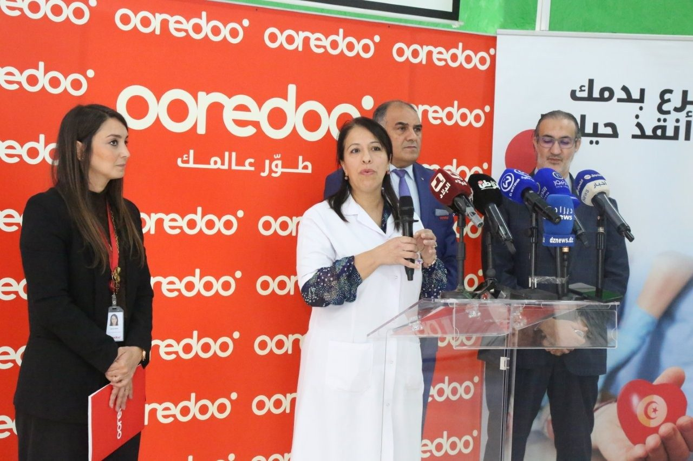

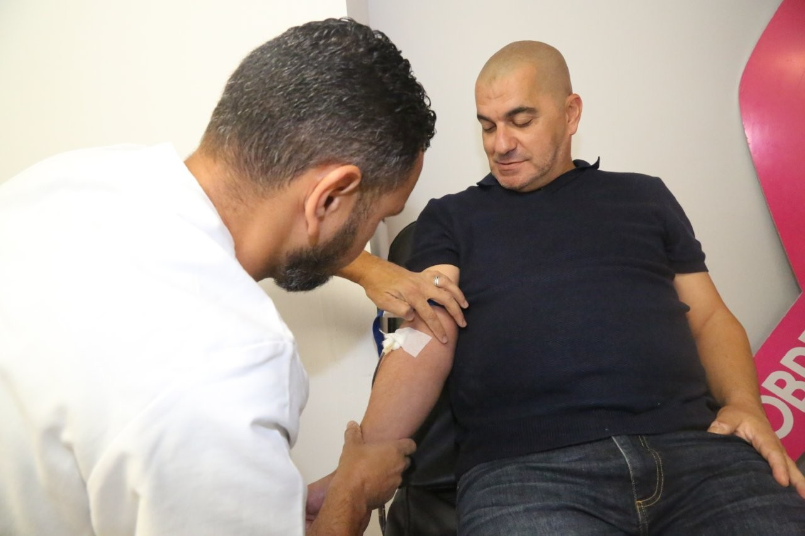

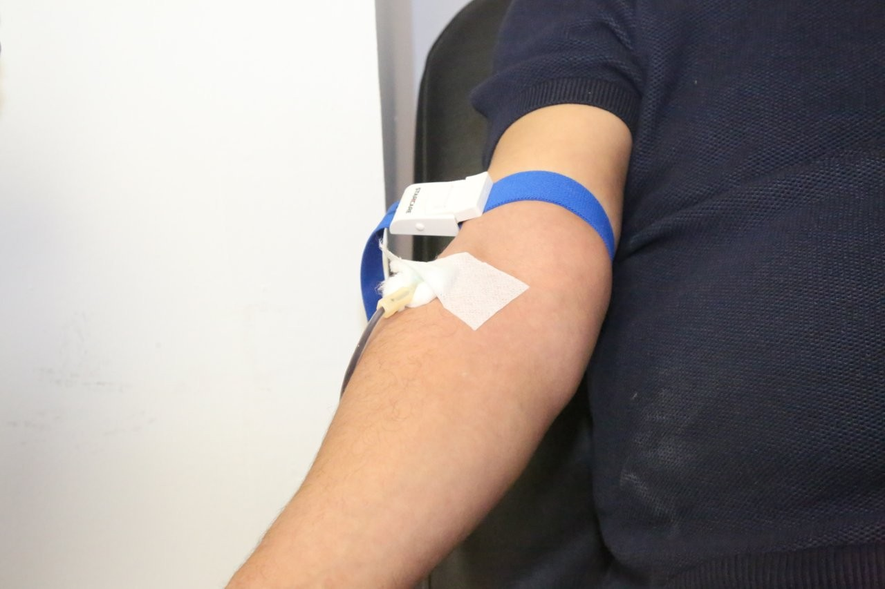

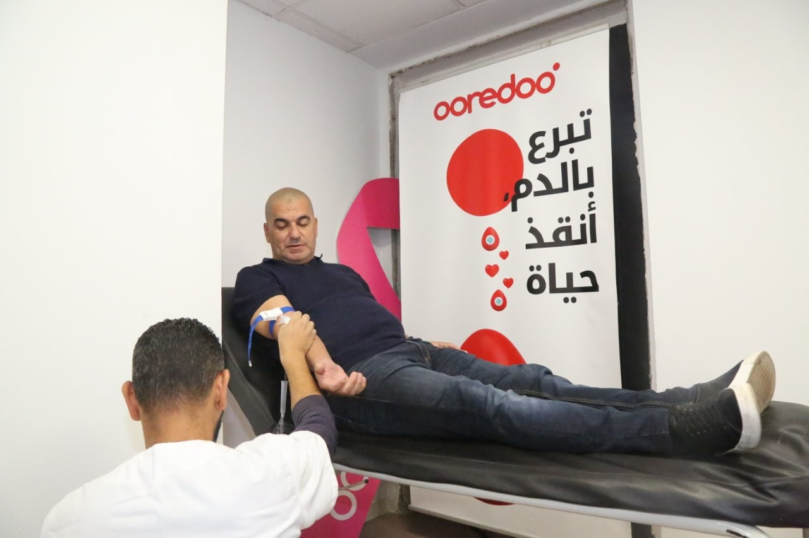

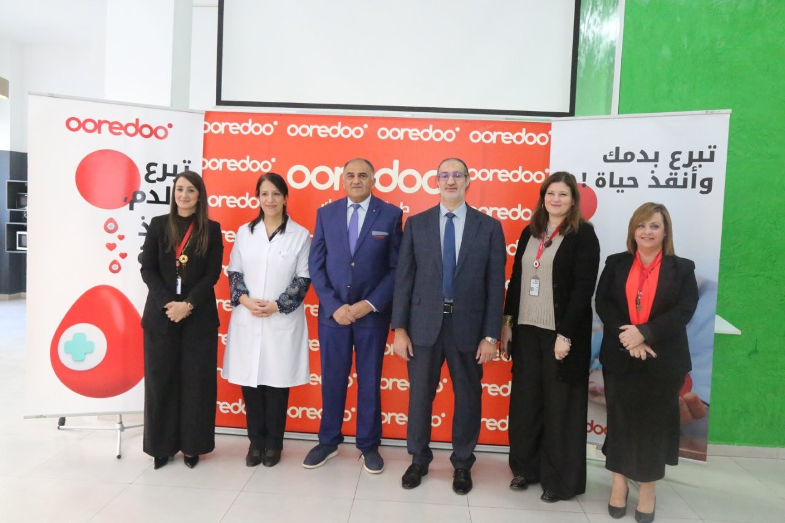

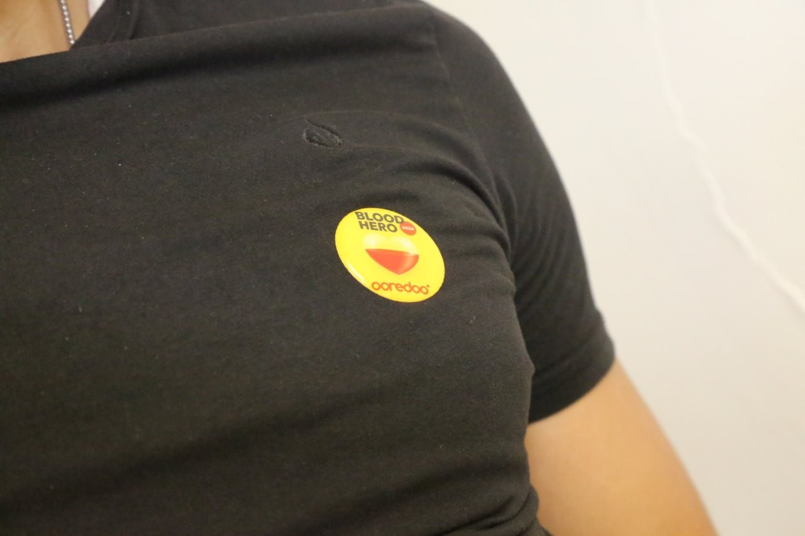

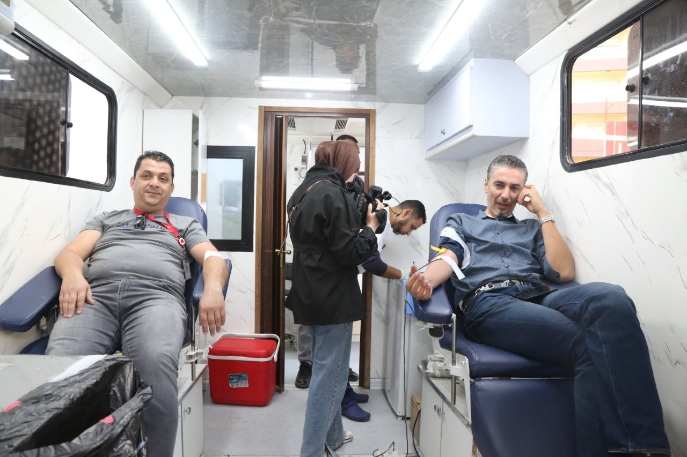

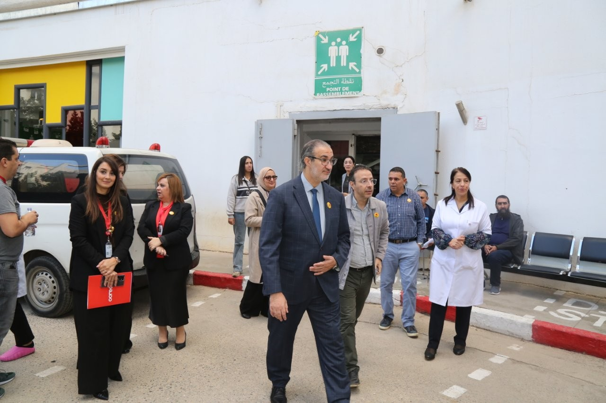

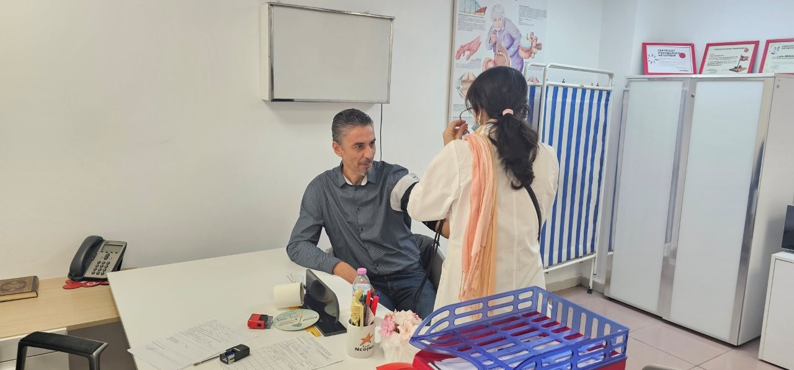
