إحياءًا لشهر نوفمبر الأزرق

Ooredoo الجزائر تنظم يومًا تحسيسيًا وترفيهيًا للكشف المبكر عن سرطان البروستات

 الجزائر، الأربعاء 25 نوفمبر 2026

وفاءً منها لالتزامها الراسخ تجاه رفاهية وصحة عمالها، نظّمت Ooredoo، يوم الثلاثاء 24 نوفمبر 2026، يوماً مخصصاً للتحسيس والوقاية من سرطان البروستات، وذلك في إطار الحملة العالمية «نوفمبر الأزرق».

وبهذه المناسبة، هيّأت المؤسسة فضاءً للراحة والترفيه صُمِّم خصيصاً لموظفيها من الرجال، حيث أتاح هذا الفضاء فرصة لتقاسم لحظات من الاستمتاع بمجموعة متنوعة من الأنشطة الترفيهية والرياضية التي وُضعت تحت تصرفهم، على غرار كرة الطاولة (البينغ بونغ)، والبلياردو، وألعاب الفيديو، فضلاً عن لعبة رمي السهام، إلى غير ذلك من الأنشطة الترفيهية.

ومزجاً بين الترفيه والوقاية الطبية، أتاحت Ooredoo لموظفيها أيضاً فرصة إجراء فحوصات طبية للكشف المبكر عن سرطان البروستات.

تندرج هذه المبادرة المواطِنة في سياق استمرارية مبادرات المسؤولية المجتمعية للمؤسسة في مجال الصحة المهنية، إذ تأتي امتداداً لحملة «أكتوبر الوردي» التي أُحييت الشهر الماضي داخل المؤسسة، والتي استفادت خلالها موظفات Ooredoo من حصص تحسيسية وتشخيصات وقائية ضد سرطان الثدي.

كما تُعزّز هذه المبادرة تقليداً راسخاً من الالتزام، حيث سبق لـ Ooredoo أن نظّمت عملية مماثلة للكشف عن سرطان البروستات لفائدة عمالها سنة 2024، وذلك بالشراكة مع الجمعية الوطنية لمساعدة المرضى (وين نلقى) .

ومن خلال هذه المبادرات المتجددة، تؤكد Ooredoo حرصها على وضع العنصر البشري في صميم أولوياتها، والترسيخ المستدام لثقافة الوقاية والرفاهية داخل بيئتها المهنية.

مديرية الشؤون المؤسساتية والعلاقات مع الإعلام والمسؤولية المجتمعية

دائرة العلاقات مع الإعلام

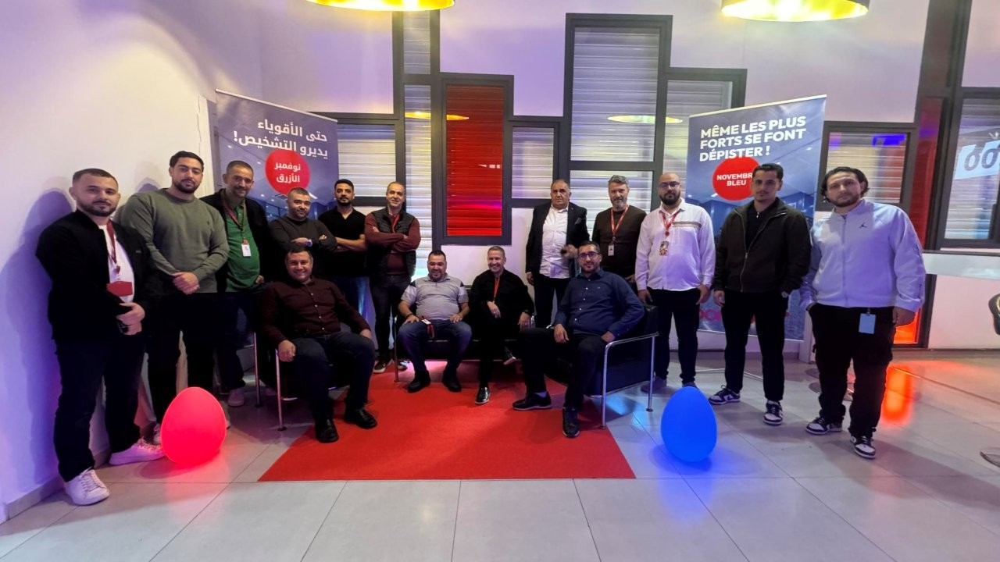

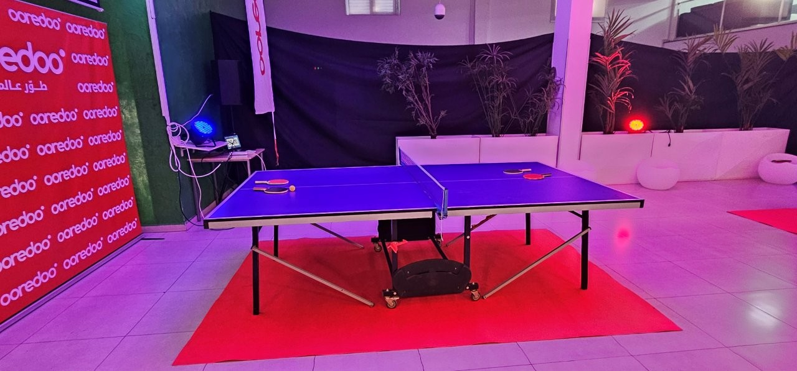

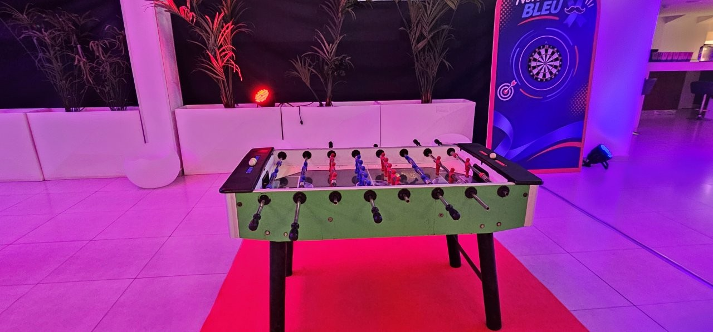

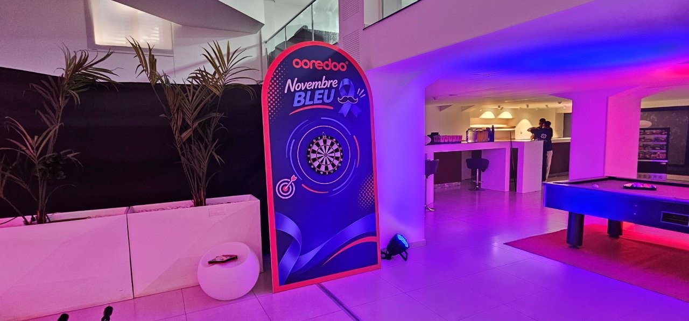

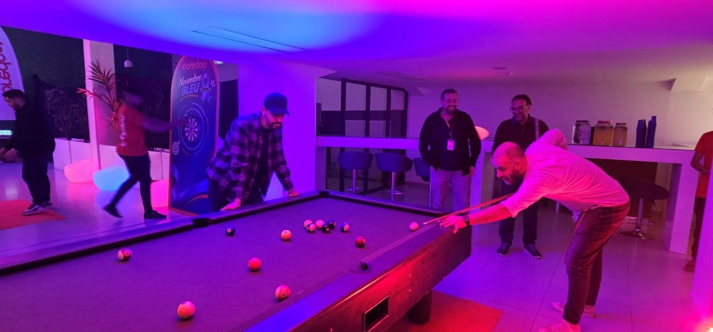

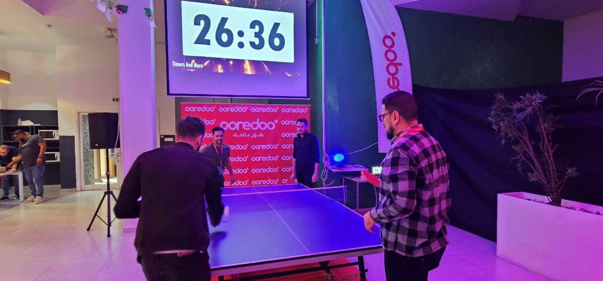

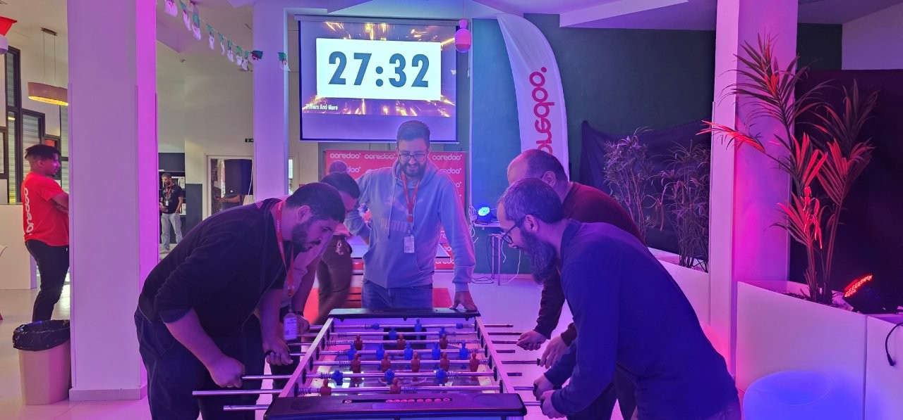

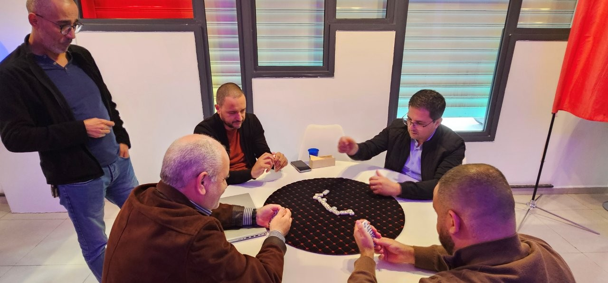

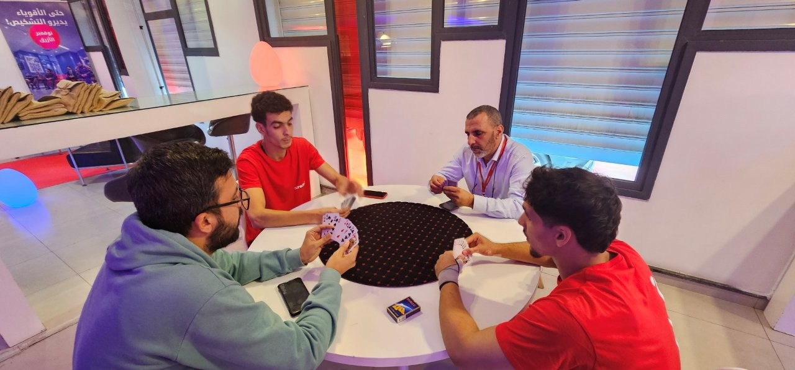

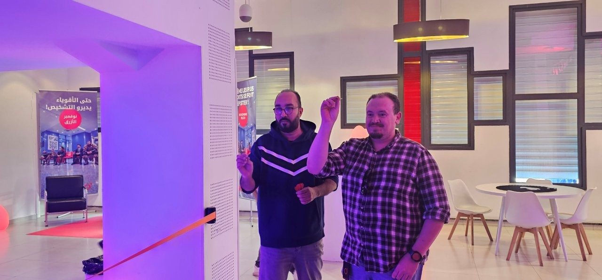

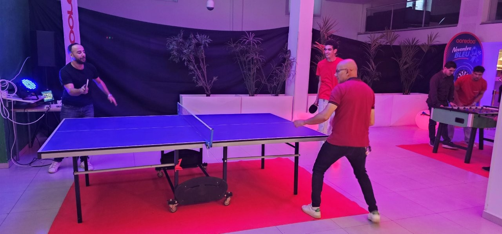

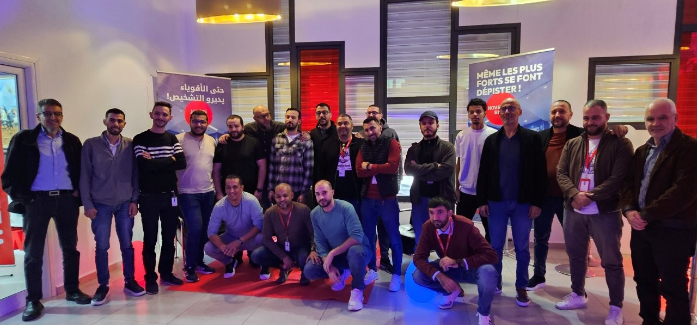

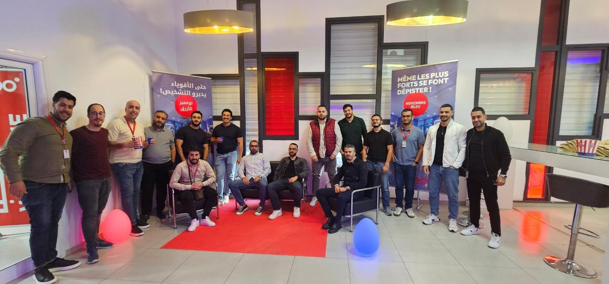
